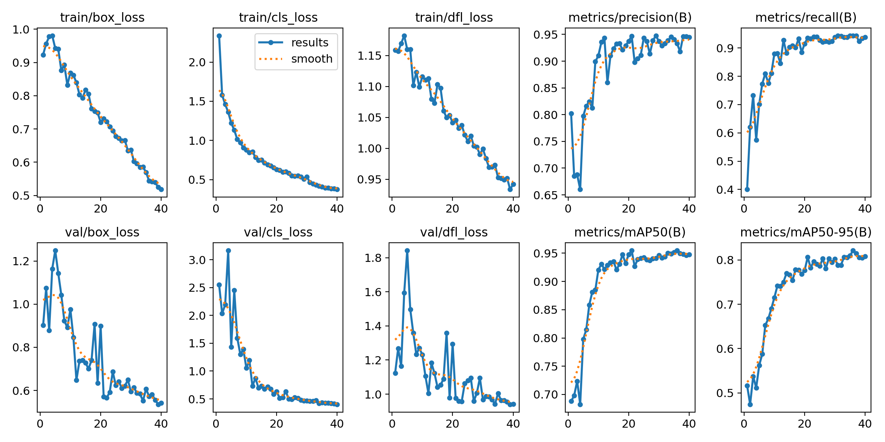
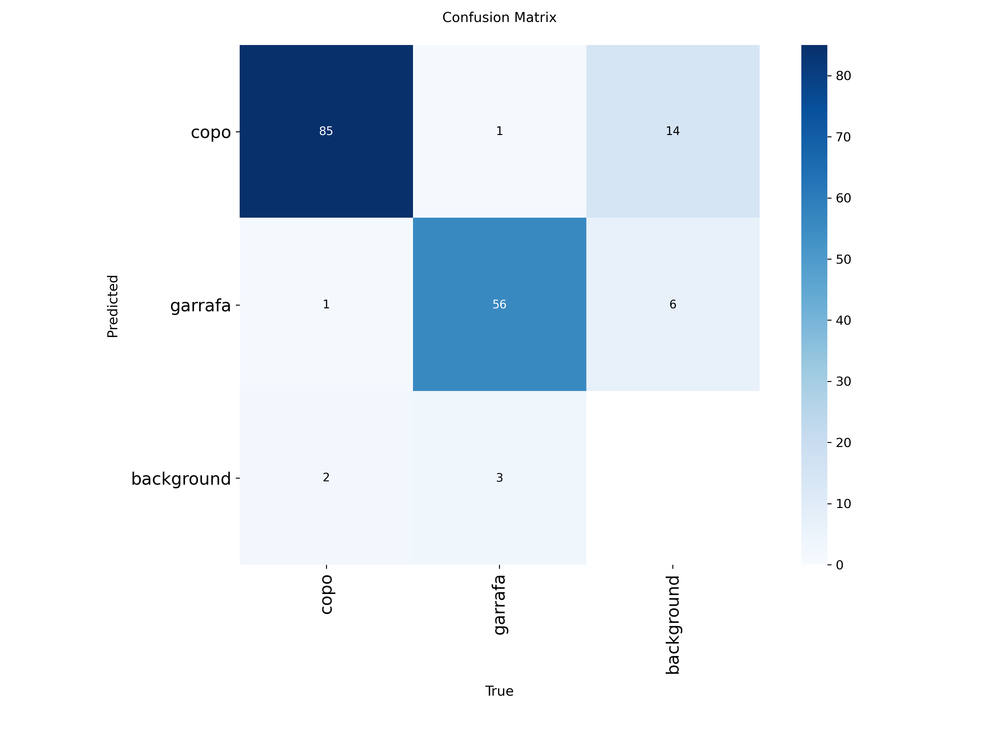
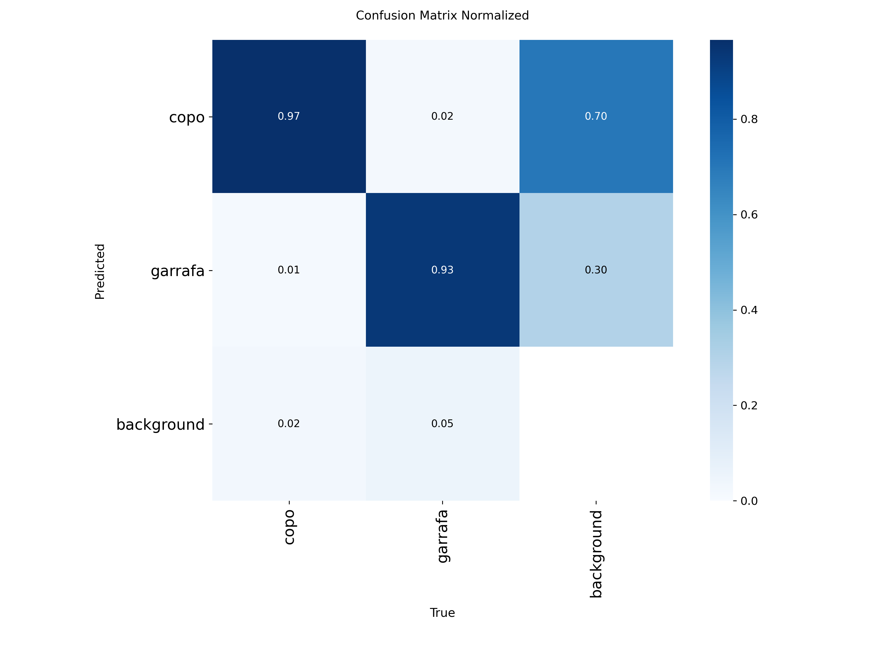
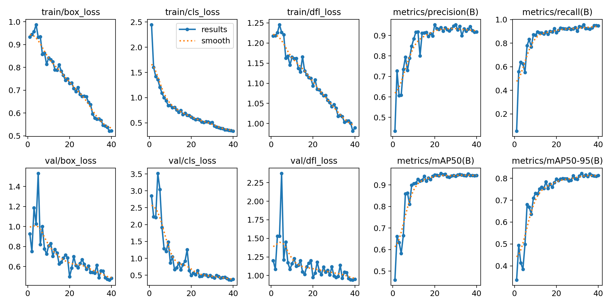
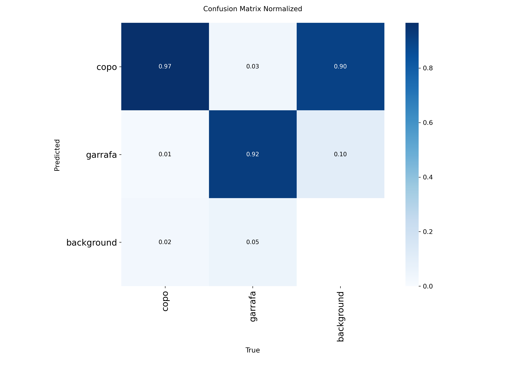
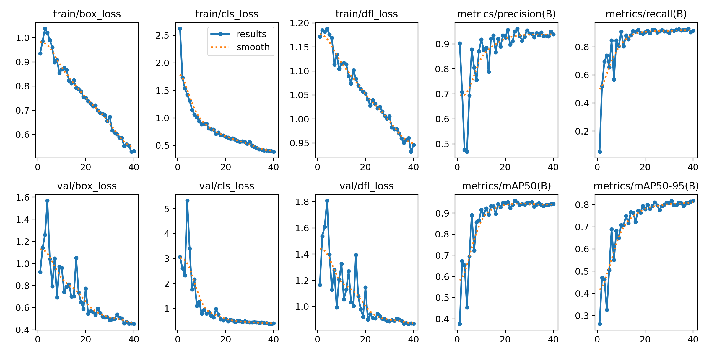
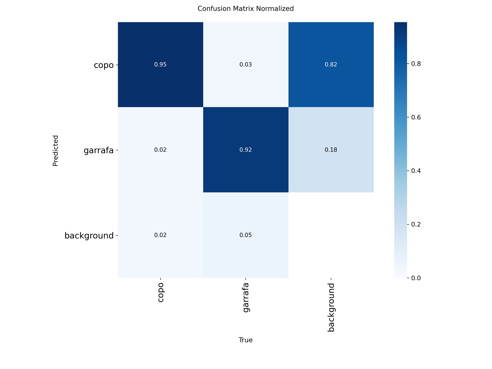

# 🥤 Detecção de Copos e Garrafas com YOLO

## 🎬 Demonstração do projeto

## 📌 Sobre o projeto

Projeto de Visão Computacional desenvolvido em Python para detectar copos e garrafas em imagens e vídeos utilizando modelos da família YOLO (*You Only Look Once*).

Foram exploradas três versões dos modelos: YOLOv8, YOLOv9 e YOLO11, com análise dos gráficos de treinamento e das matrizes de confusão.

## 🛠️ Tecnologias utilizadas

- Python
- Ultralytics YOLO
- OpenCV
- NumPy
- Roboflow
- Google Colab

## ⚙️ Configuração do treinamento

| Parâmetro | Configuração |
|---|---|
| Modelos | YOLOv8, YOLOv9 e YOLO11 |
| Épocas | 40 |
| Tamanho da imagem | 640 × 640 pixels |
| Classes | Copos e garrafas |

---

## 🔵 YOLOv8

O YOLOv8 foi utilizado para realizar a detecção de objetos e avaliar a evolução do treinamento.

### Resultados do treinamento

### Matriz de confusão

### Matriz de confusão normalizada

---

## 🟢 YOLOv9

O YOLOv9 foi treinado para a mesma tarefa, permitindo analisar suas métricas e a distribuição dos acertos e erros.

### Resultados do treinamento

### Matriz de confusão

### Matriz de confusão normalizada

---

## 🟣 YOLO11

O YOLO11 foi utilizado como terceira abordagem para a detecção de copos e garrafas.

### Resultados do treinamento

### Matriz de confusão

### Matriz de confusão normalizada

---

## 🔍 Análise dos resultados

Os gráficos de treinamento permitem acompanhar a evolução das perdas e das métricas ao longo das épocas. As matrizes de confusão ajudam a visualizar os acertos e as confusões entre as classes.

A comparação final entre os modelos deve considerar as métricas obtidas na validação, incluindo precisão (*precision*), revocação (*recall*) e comportamento das perdas. Não é possível afirmar qual versão teve o melhor desempenho sem analisar os valores registrados.

## 📚 Aprendizados

- Treinamento de modelos de detecção de objetos com YOLO.
- Preparação de dados para Visão Computacional.
- Processamento de imagens e vídeos com OpenCV.
- Análise de métricas de treinamento e matrizes de confusão.
- Comparação de diferentes versões de modelos de Deep Learning.

## 👩‍💻 Autora

**Larissa Cardozo**

Estudante de Engenharia da Computação, com interesse em Inteligência Artificial, Machine Learning e Visão Computacional.
